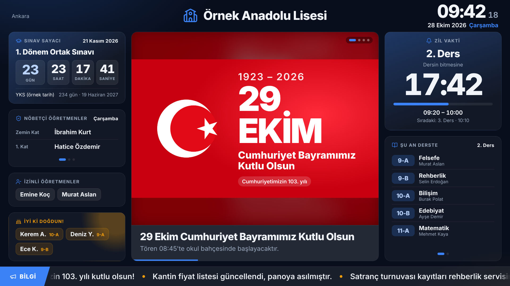
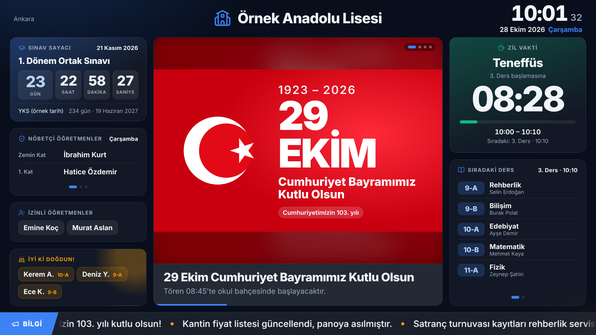
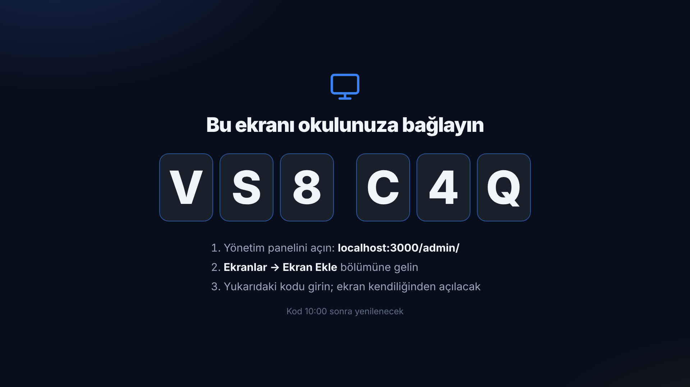
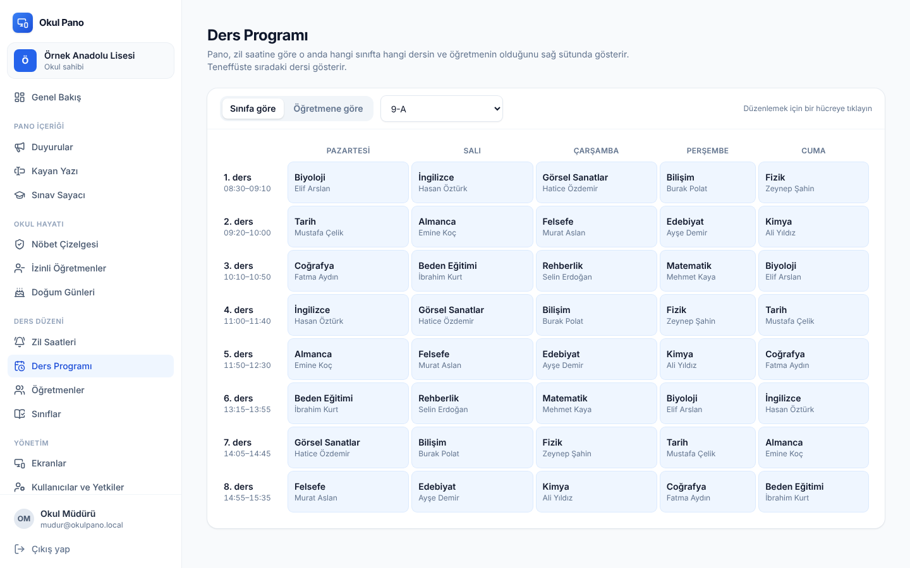
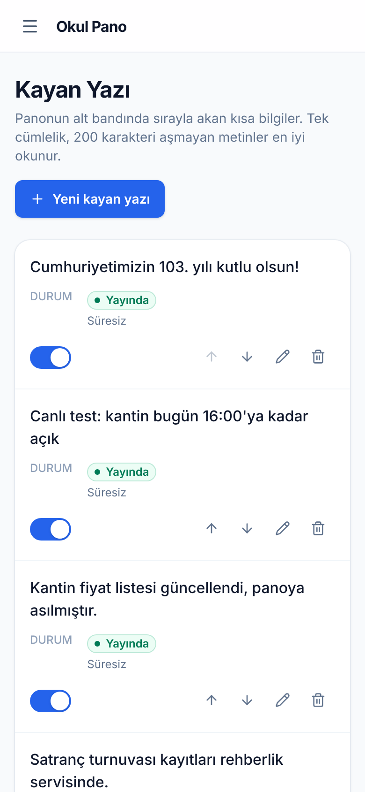
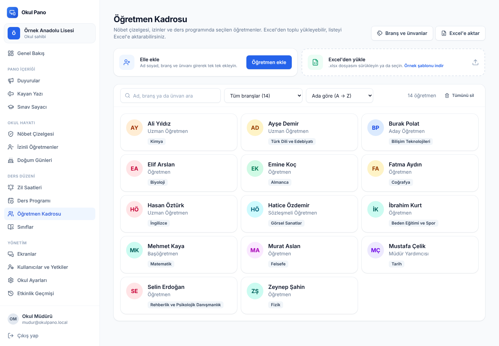

# Okul Pano

Okullar için **çok okullu (SaaS'a hazır)** dijital pano sistemi: koridordaki TV'ler, uzaktan erişilen bir yönetim paneli, öğretmen ve yöneticiler için mobil uygulama ve hepsinin kullandığı tek bir API.



| Teneffüste | TV eşleştirme | Ders programı (panel) | Telefon |
|---|---|---|---|
|  |  |  |  |

## Pano alanları

| Alan | İçerik |
|---|---|
| **Üst bar** | Solda hava durumu, ortada okul logosu ve adı, sağda saat ve tarih |
| **Sol sütun** | Sınav sayacı (LGS/YKS vb.), bugünün nöbetçi öğretmenleri ve nöbet yerleri, izinli öğretmenler *(gizlenebilir)*, doğum günü kutlamaları *(gizlenebilir)* |
| **Orta alan** | Görselli duyurular, YouTube videoları ve metin duyurular; slayt olarak döner, yayın tarihi planlanabilir |
| **Sağ sütun** | Zil vakti: dersin ya da teneffüsün bitmesine kalan süre. Altında o ders saatinde hangi sınıfta hangi ders ve öğretmen var |
| **Alt bant** | Panelden girilen kısa bilgilerin aktığı kayan yazı |

## Öğretmen kadrosu



- **Elle ekleme ve Excel'den yükleme:** ad soyad, branş ve ünvan. Formdan çıkmadan yeni branş/ünvan eklenebilir; "Kaydet ve yenisini ekle" ile hızlı giriş yapılır.
- **Örnek Excel şablonu:** Branş ve Ünvan sütunlarında okulun kendi listelerinden açılır menü var. Listede olmayan bir değer yazılırsa Excel uyarır, içe aktarırken yeni değer olarak eklenir.
- **İki adımlı içe aktarma:** Dosya önce okunur; kaç yeni, kaç güncellenecek, hangi satırların neden atlanacağı (satır numarasıyla) gösterilir, onaylanınca kaydedilir. Aynı isimli öğretmen tekrar yüklenirse çift kayıt açılmaz, bilgisi güncellenir. Adı ve soyadı ayrı sütunlu listeler (ör. MEBBİS çıktısı) de okunur.
- **Excel'e aktarma:** Dışa aktarılan dosya şablonla aynı yapıdadır; düzenlenip geri yüklenebilir.
- **Kart görünümü:** Düzenle ve sil düğmeleri masaüstünde kartın üzerine gelince, dokunmatik ekranlarda her zaman görünür.
- **Arama, branşa göre filtre, ada / soyada göre sıralama** (Türkçe alfabe sırasıyla).
- **Branş ve ünvan yönetimi:** Bir branşın adı değişince o branştaki tüm öğretmenlerde değişir. Yeni okullar önerilen MEB branşları ve ünvanlarıyla açılır.
- **Tümünü sil:** Silinecek nöbet ve izin kayıtlarının sayısını gösterir, "SİL" yazarak onay ister.

## Excel ile öğrenci ve nöbet çizelgesi

Öğretmen kadrosundaki Excel altyapısı **Doğum Günleri (öğrenciler)** ve **Nöbet Çizelgesi** sayfalarında da var: örnek şablon, iki adımlı içe aktarma (önizleme → onay) ve dışa aktarma.

- **Öğrenciler:** Ad Soyad, Sınıf, Doğum Tarihi. e-Okul listeleri olduğu gibi okunur: "Adı / Soyadı" ya da "Sınıfı / Şubesi" ayrı sütunlarda olabilir, okul numarası yok sayılır. Sınıf "9/A", "9A", "9. Sınıf A Şubesi" yazılsa da "9-A" olur; listede olmayan sınıf oluşturulur. Tarih Excel tarihi, "14.03.2010" ya da "2010-03-14" olabilir; 31 Şubat gibi geçersiz tarihler satır numarasıyla bildirilir. Öğrenci "ad soyad + doğum tarihi" ile tanınır: yeniden yüklemek çift kayıt açmaz, yeni dönemde sınıfı güncellenir; aynı isimli iki öğrenci karışmaz.
- **Nöbet çizelgesi:** Okulların kâğıtta kullandığı biçimde, satırlarda nöbet yerleri ve sütunlarda günler. Hücrelerde kadrodaki öğretmenler açılır listede; bir yerde birden fazla öğretmen virgülle yazılır. Dışa aktarılan dosya yatay A4'e sığacak şekilde ayarlıdır, yazdırılıp asılabilir. Yüklerken "Çizelgeyi değiştir" (dosyadaki günler yenilenir, hafta sonu gibi dosyada olmayan günlere dokunulmaz) ya da "Mevcut çizelgeye ekle" seçilir; kaldırılacak nöbetler önceden listelenir. Kadroda olmayan isim atlanır ve benzer isim önerilir ("Hasan Ozturk" → "Hasan Öztürk mi?"). "Gün | Nöbet Yeri | Öğretmen" sütunlu uzun listeler de okunur.

## Mobil uygulama ve uzaktan yönetim

Expo (React Native) ile yazılmış tek uygulama; ekranlar kişinin yetkisine göre değişir. Ayrıntılar: [mobile/README.md](mobile/README.md).

| Öğretmen | Yönetici |
|---|---|
| **Bugün:** şu anki ders, teneffüse kalan süre, bugünkü nöbeti ve ders programı | **Kontrol merkezi:** çevrimiçi pano, onay bekleyen, yayındaki içerik; boş nöbet, kapalı pano gibi ilgilenilmesi gerekenler |
| **Nöbetlerim:** haftalık şerit (tatiller soluk), birlikte nöbet tutanlar, nöbet günü sabah hatırlatma | **Onaylar:** duyuru ve izin bildirimleri tek dokunuşla onay / geri gönder |
| **Hızlı duyuru:** hazır şablon ya da telefonla çekilen fotoğraf, canlı önizleme, onaya gönderme | **Pano uzaktan kumanda:** canlı önizleme, sonraki / önceki / bu içerikte durdur, ekran modu, uyut / uyandır |
| **İzin bildirimi:** onaylanınca panoda izinli görünür | **Boş nöbet:** izinli öğretmenin nöbeti için öneriler (o gün nöbeti olmayan, bu ay en az nöbet tutan); "Ata" ile bildirim gider |
| | **Acil durum:** 3 saniye basılı tutunca bütün panolarda uyarı ve herkesin telefonuna bildirim |

Telefon bildirimleri (Expo push): onaya düşen duyuru ve izin, onay sonucu, acil durum, nöbet görevlendirmesi, 10 dakikadır kapalı pano. Aynı uygulamanın web sürümü sunucunun `/app/` adresinden açılır; uygulama kurmayan öğretmenler tarayıcıdan kullanır.

## Öne çıkan teknik kararlar

- **Gerçek zamanlı:** Panelde yapılan her değişiklik ekranlara Server-Sent Events ile yaklaşık bir saniyede ulaşır. Ekranlar uzaktan yenilenebilir ya da "Tanımla" ile adını gösterebilir.
- **TV'de klavye gerekmez:** Ekran 6 haneli bir kod gösterir; yönetici panele kodu girince ekran kalıcı anahtarını alır (Netflix/Chromecast tarzı eşleştirme).
- **İnternet kesilirse çalışmaya devam eder:** Pano haftalık veriyi (nöbet, ders programı, zil saatleri) önbelleğe alır ve hangi günün gösterileceğine kendisi karar verir.
- **Saat her zaman doğru:** Zil ve geri sayımlar cihaz saatine değil, sunucu saatine ve okulun saat dilimine göre hesaplanır.
- **Her TV'de aynı görünüm:** Pano 1920×1080 tuvalde tasarlanır ve her ekran çözünürlüğüne orantılı ölçeklenir. Görüntü izine karşı içerik birkaç dakikada bir 2-3 piksel kayar. Gece 03:00'te sayfa kendini tazeler.
- **Rol ve yetki:** Okul sahibi ve yönetici her şeyi yönetir. Editörlere bölüm bölüm yetki verilir; örneğin yalnızca duyuru ya da yalnızca nöbet. Editörler kimseye yetki veremez. Her değişiklik etkinlik geçmişine yazılır.
- **Çok okullu (multi-tenant):** Tüm veriler okul kimliğiyle izole edilir; başka okulun kaydına ID bilinse bile erişilemez. Paket ve ekran limiti alanları abonelik sistemine hazırdır.
- **Mobil uygulamaya hazır:** Tipler, doğrulama şemaları ve zil motoru `packages/shared` içindedir. API, mobil istemciler için yenileme anahtarını gövdede döndürür.
- **Küçük ayrıntılar:** Panelde "zaman makinesi" ile panonun herhangi bir anda nasıl görüneceği önizlenir. Aynı öğretmen aynı saatte iki sınıfa yazılamaz. 29 Şubat doğumlular artık olmayan yıllarda 28 Şubat'ta kutlanır. Öğrenci adları KVKK dostu biçimde gösterilir ("Ayşe Y."). Millî bayramlarda bant kırmızı-beyaz olur, 10 Kasım 09.05'te pano saygı ekranına geçer.

## Mimari

```
okul-pano/
├── packages/shared   Ortak TypeScript: Zod şemaları, yetki modeli, zil motoru, saat dilimi
├── packages/slides   Hazır duyuru şablonlarının görünümü (pano ve panel önizlemesi aynı bileşen)
├── apps/api          Fastify + Drizzle ORM · PostgreSQL (geliştirmede gömülü PGlite)
├── apps/admin        Yönetim paneli · React + TanStack Query + Tailwind · /admin/
├── apps/display      Pano · React, düşük güçlü cihazlar için hafif paket · /display/
└── mobile            Mobil uygulama · Expo (React Native) · web sürümü /app/ (ayrı npm kurulumu)
```

Üretimde tek bir Node süreci API'yi, paneli ve panoyu aynı adresten sunar; önüne otomatik HTTPS veren Caddy konur.

## Hızlı başlangıç (geliştirme)

Gereksinim: Node.js 22.12 veya üzeri. Veritabanı kurmanız gerekmez; gömülü PGlite kullanılır.

```bash
cd okul-pano
npm install
npm run seed      # örnek okul, öğretmenler, ders programı ve afişler
npm run dev       # API :3000, panel :5173/admin/, pano :5174/display/
```

| Hesap | E-posta | Şifre |
|---|---|---|
| Platform yöneticisi | admin@okulpano.local | Pano2026! |
| Okul sahibi | mudur@okulpano.local | Mudur2026! |
| Editör (duyuru + kayan yazı) | editor@okulpano.local | Editor2026! |
| Öğretmen (mobil uygulama) | ogretmen@okulpano.local | Ogretmen2026! |

`npm run seed` çıktısındaki bağlantı örnek ekranı doğrudan açar. Belirli bir anı denemek için panoya `&at=2026-10-28T09:42:00+03:00` ekleyin.

```bash
npm test          # 70 birim + 86 entegrasyon testi
npm run typecheck
npm run build     # üretim derlemesi
```

## Sunucuya kurulum

**Ücretsiz deneme yayını (kredi kartı gerekmez):** Render + Neon ile birkaç adımda; ayrıntılı rehber
[docs/ucretsiz-yayin.md](docs/ucretsiz-yayin.md).

**Türkiye'deki bir sunucu (VPS, KVKK için önerilen):** tek komutla kurulum, otomatik HTTPS ve gece yedeği;
rehber [docs/vps-kurulum.md](docs/vps-kurulum.md).

```bash
curl -fsSL https://raw.githubusercontent.com/Ertan88/antigravity-web-design-skills/claude/okul-dijital-pano-4oao0y/okul-pano/deploy/kurulum.sh | sudo bash
```

**Kaynaktan derleyerek (docker compose):**

```bash
cp deploy/.env.example deploy/.env      # alan adı ve gizli anahtarlar
docker compose --env-file deploy/.env up -d --build
```

Panel `https://alanadiniz/admin/`, pano `https://alanadiniz/display/`, mobil uygulamanın web sürümü `https://alanadiniz/app/` adresinde açılır. TV tarafında Chromium'u kiosk modunda çalıştırmanız yeterli; komut paneldeki **Ekranlar** sayfasında yazar.

## Kayıt, deneme ve davet

- **Kayıt yalnızca web'den:** `https://alanadiniz/admin/kayit`. Okul bilgileri ve yetkili hesabı alınır; e-posta doğrulanınca okul
  deneme paketiyle açılır (varsayılan 30 gün, 2 pano: `TRIAL_DAYS`, `TRIAL_SCREENS`). Kayıt yapan okul sahibi olur.
- **Kayıt modu** (`SIGNUP_MODE`): `open` doğrulayınca açılır, `approval` platform yöneticisinin onayını bekler, `closed` kapalı.
- **E-posta:** `BREVO_API_KEY` (HTTPS, önerilen; Render'ın ücretsiz sunucusu SMTP portlarını kapatır) ya da `SMTP_HOST`.
  Gönderen `SMTP_FROM="Okulyayın <adres@alanadi.com>"` Brevo'da doğrulanmış olmalı. Gönderim hataları sunucu günlüğüne yazılır.
- **E-posta gelmezse** (e-posta ayarlı değilse) başvuru **Platform › Okullar ve Abonelikler** sayfasında "Onayla" ile açılır.
- **Deneme süresi:** bitişe 7, 3, 1 gün kala ve bitince okul sahibine e-posta; süre dolunca panel salt okunur, panolar "deneme
  süresi sona erdi" ekranı gösterir. Platform yöneticisi "+30 gün" ile uzatır ya da ücretli pakete geçirir.
- **Davet:** okul sahibi kullanıcı eklerken "Davet bağlantısı gönder"i seçer; kişi şifresini bağlantıdan kendisi belirler.
  Mobil uygulamada kayıt yoktur; giriş ekranındaki bağlantı web'deki kayıt sayfasını açar.
- **Tatiller, arifeler ve köprü günleri** (Zil Saatleri › Tatiller ve arifeler): resmî ve dini tatillerde zil çalmaz; panodaki
  "Sıradaki Ders" tatilden sonraki ilk ders gününü gösterir. Arifede (Ramazan, Kurban, Cumhuriyet Bayramı) dersler okulun
  belirlediği son zilde (varsayılan 13:00) biter. Bayrama bitişik 1–2 iş günü "olası köprü günü" olarak önerilir; idari izin
  ilan edilirse tek tıkla tatil yapılır.
- **Bildirimler** (panelde sağ üstteki zil › Tüm bildirimler; mobilde Bildirimler): okunanlar da 180 gün saklanır, okundu
  bilgisi her cihazda aynıdır. İşi biten bildirimler (duyuru onaylandı, nöbet dolduruldu) "Tamamlandı" olarak geçmişte kalır.
- **KVKK ve destek erişimi:** platform yöneticisi Platform sayfasında okulların yalnızca abonelik bilgilerini görür; okul verilerine
  ancak üye olduğu okulda ya da okul sahibinin **Genel Ayarlar › Destek erişimi** bölümünden verdiği süreli (24 saat / 7 gün)
  erişimle girer; erişim verilince, kapatılınca ya da süresi dolunca panelde bildirim düşer ve okul sayfa yenilenmeden listeye gelir. Kendi okulunuzda okul sahibi olmak için `PLATFORM_OWNER_SCHOOLS=okul-kisa-adi` (virgülle birden çok) yazın.

## Başlıklar

Panel › **Başlıklar**: panodaki kart adları (Nöbetçi Öğretmenler, Sınav Sayacı…) ve Nöbet Çizelgesi sekmeleri okulun kullandığı
adlarla değiştirilebilir (ör. "Servis Nöbetçileri"); boş bırakılan başlık varsayılanı kullanır. Okul sahibi, yönetici ve
"Başlıkları düzenleme" yetkisi verilen kullanıcılar değiştirebilir; platform yöneticisi her okulda.

## KVKK

- **Aydınlatma metni:** her okul kendi metnini **Okul Ayarları › Kişisel veriler (KVKK)** bölümünde yazar
  ("Şablondan doldur" okulun adıyla genel bir taslak getirir; adres ve iletişim bilgisi okulca tamamlanır).
  Metin `https://alanadiniz/aydinlatma/<okul-kısa-adı>` adresinde herkese açık yayınlanır.
- **Verileri dışa aktarma:** okul sahibi ya da platform yöneticisi okulun bütün verisini (görseller dahil) tek
  JSON dosyası olarak indirir. Şifre özetleri ve pano anahtarları dosyaya girmez.
- **Okulu tamamen silme:** platform yöneticisi **Okullar ve Abonelikler** sayfasından, okulun kısa adını yazarak onaylar; okulun
  bütün kayıtları, görselleri ve yalnızca o okula bağlı kullanıcı hesapları silinir.
- **Sağlık verisi tutulmaz:** izin notu alanı "sağlık bilgisi yazmayın" uyarısı taşır.
- Şablondaki "verilerin saklandığı yer" sunucunun `DATA_REGION` ayarından gelir (varsayılan `Türkiye`).

Şablon yol gösterir; satıştan önce metnin bir hukukçuya okutulması önerilir.

## Yol haritası

1. **Bu sürüm:** pano, yönetim paneli, yetkiler, ekran eşleştirme, canlı güncelleme, onay akışı, acil durum, tatil takvimi, panoya özel içerik, mobil uygulama (öğretmen + yönetici), uzaktan kumanda, nöbet yerine görevlendirme, telefon bildirimleri.
2. **Sıradaki:** nöbet değişimi isteği (öğretmenler arası), telefon ana ekranı bileşeni ("Teneffüse 12 dk · Nöbet: Bahçe"), veli / öğrenci için salt okunur sürüm.
3. **Abonelik:** iyzico/Stripe ile ödeme, paket limitlerinin otomatik uygulanması, okulların kendi kendine kaydı.
