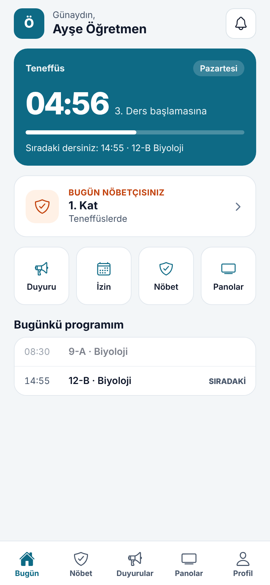
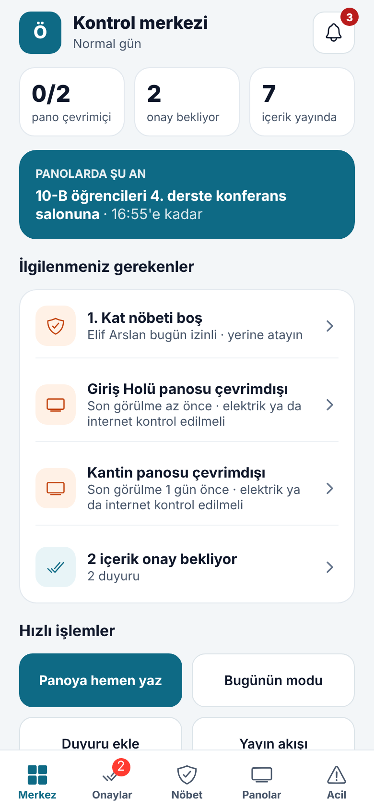
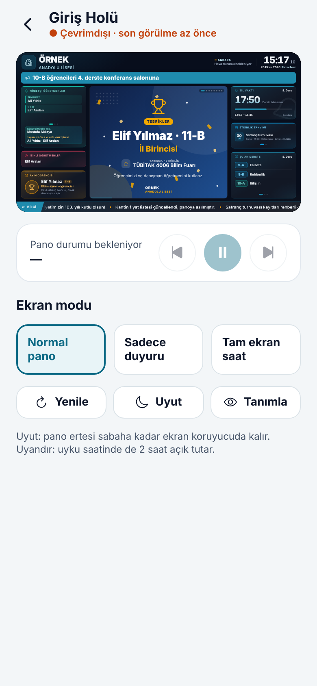
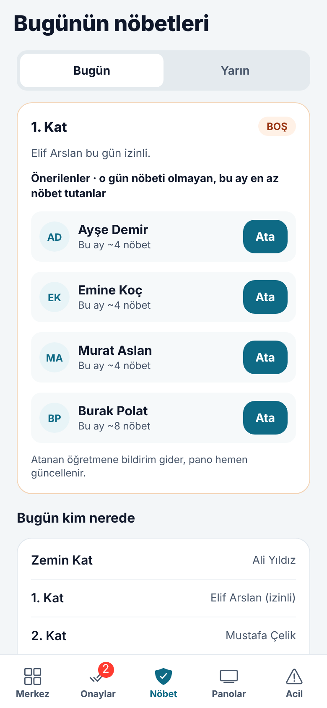

# Okul Pano · Mobil uygulama

Öğretmen ve yöneticiler için tek uygulama (Expo / React Native, Android + iPhone + web). Ekranlar kişinin
yetkisine göre değişir; hiçbir okul, il ya da kişi bilgisi koda gömülü değildir. Her şey giriş yapılan okulun
kendi verisinden gelir.

| Kim | Alt menü |
|---|---|
| Öğretmen (hesabı öğretmen kaydına bağlı) | Bugün · Nöbet · Duyurular · Panolar · Profil |
| Yönetici (onay, pano, nöbet ya da acil durum yetkisi olan) | Merkez · Onaylar · Nöbet · Panolar · Acil |

Ders veren bir müdür yardımcısı yönetici menüsünü görür; kontrol merkezinin altında "Benim günüm" kartı çıkar.

| Öğretmen: Bugün | Yönetici: Kontrol merkezi | Pano uzaktan kumanda | Boş nöbet ve görevlendirme |
|---|---|---|---|
|  |  |  |  |

## Telefonda denemek (Expo Go)

1. Sunucu çalışsın: depo kökünde `npm run dev` (API `:3000`).
2. Bu klasörde:
   ```bash
   cd okul-pano/mobile
   npm install
   npx expo start
   ```
3. Telefona **Expo Go** uygulamasını kurun, terminaldeki QR kodu okutun.
4. Giriş ekranında **Sunucu adresi**: bilgisayarın yerel ağ adresi, ör. `http://192.168.1.20:3000`
   (telefon ve bilgisayar aynı Wi-Fi'da olmalı). Örnek hesaplar:
   - Yönetici: `mudur@okulpano.local` / `Mudur2026!`
   - Öğretmen: `ogretmen@okulpano.local` / `Ogretmen2026!`

Öğretmen ekranlarının (Bugün, Nöbetlerim, İzin) dolması için kullanıcı hesabı bir öğretmen kaydına bağlı olmalı:
panelde **Kullanıcılar ve Yetkiler** › "Öğretmen kaydı" sütunu. Örnek verideki öğretmen hesabı bağlı gelir.

## Web sürümü (/app/)

Aynı uygulama tarayıcıda da çalışır; sunucu derlenmiş sürümü `/app/` adresinden sunar (uygulama kurmayan öğretmenler
için). Derleme:

```bash
npx expo export --platform web --output-dir dist   # sunucu ../../mobile/dist klasörünü /app/ olarak sunar
```

Docker imajı bunu kendiliğinden yapar.

## Mağaza sürümü ve telefon bildirimleri

Uzaktan bildirimler (onay bekleyen duyuru, acil durum, nöbet görevlendirmesi, kapanan pano) **Expo push** servisiyle
gönderilir. Bunun için:

1. [expo.dev](https://expo.dev) hesabı açın, `npx eas init` ile projeyi bağlayın (`app.json` içine `extra.eas.projectId` yazılır).
2. Android için Firebase (FCM) anahtarını, iPhone için Apple push anahtarını `eas credentials` ile tanımlayın.
3. Derleyin: `npx eas build -p android` ve `npx eas build -p ios`, mağazaya gönderin: `npx eas submit`.
4. Expo hesabında "push güvenliği" açıksa sunucunun `.env` dosyasına `PUSH_ACCESS_TOKEN=...` ekleyin.

Notlar:
- Android'de Expo Go uzaktan bildirim almaz; denemek için `npx eas build --profile development` ile geliştirme
  sürümü kurun. Nöbet hatırlatmaları (telefonda yerel kurulur) Expo Go'da da çalışır.
- Sunucu tarafında bildirim gönderimini kapatmak için `PUSH_URL=off`.

## Klasörler

```
app/                 Ekranlar (expo-router: dosya adı = adres)
  (tabs)/            Alt menü: index (Bugün / Merkez), nobet, onaylar, duyurular, panolar, acil, profil
  pano/[id].tsx      Pano uzaktan kumanda
  anlik-mesaj.tsx    Panoya hemen yaz
  gun-modu.tsx       Bugünün modu ve zil kaydırma
  yayin-akisi.tsx    Yayın akışı
  duyuru-yeni.tsx    Hızlı duyuru (şablon / fotoğraf)
  izin.tsx           İzin bildirimi
  bildirimler.tsx    Bildirimler
src/                 Oturum, API, veri sorguları, ortak bileşenler
```

Zil hesabı, günün modu, şablonlar ve tipler `../packages/shared` paketinden olduğu gibi kullanılır (pano ve panelle
aynı kod). Bu klasörün bağımlılıkları ayrıdır; ana `npm install` mobil paketleri kurmaz.
